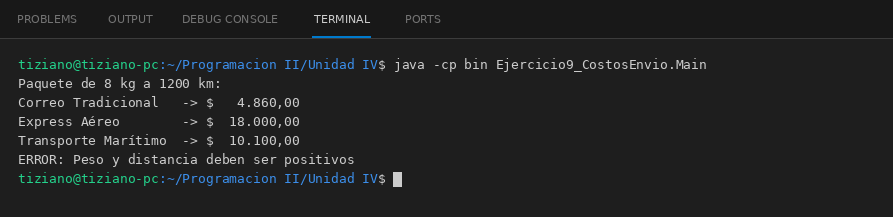

# Transportista

Programación II - Unidad 4 - Ejercicio 9

## Consigna
Cotizar un mismo paquete con distintos transportistas, cada uno con su fórmula tarifaria.

## Lógica
- Clase abstracta `Transportista` (nombre, tarifaBase) con `double calcularCostoEnvio(pesoKg, distanciaKm)`; valida que peso y distancia sean positivos.
- `CorreoTradicional`, `EnvioExpressAereo` (con recargo de urgencia) y `TransporteMaritimo` (peso mínimo facturable de 50 kg) usan factores propios.
- `CotizadorEnvios` cotiza con cualquier `Transportista` y compara varias opciones.
- `Main`: compara un paquete de 8 kg a 1200 km y muestra el error de un peso negativo.

## Ejecución

